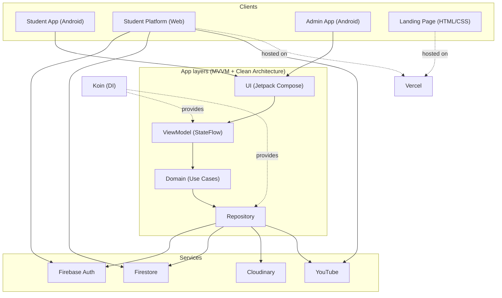

# EdTech-Platform

A real-world Learning Management System (LMS) built for private teachers: a **student platform** (Android + Web), an **admin app** (Android), and an **SEO-friendly landing page**. It includes a secure exam system with anti-cheat, protected video and PDF content, a virtual credit system with redeemable codes, and a full admin panel for managing students.

> **Note:** This repository is a showcase. Full source code is available on request (see [Contact](#contact)).

---

## Try it

| | |
|---|---|
| 📱 **Student app (APK)** | [Download from Releases](https://github.com/Ahmed-Yasser-ElMaradny/EdTech-Showcase/releases/download/v1.0/AdminApp.apk) |
| 🛠️ **Admin app (APK)** | [Download from Releases](https://github.com/Ahmed-Yasser-ElMaradny/EdTech-Platform/releases) |
| 🌐 **Student platform (Web)** | [LIVE_DEMO_LINK](https://example.com) |
| 🔎 **Teacher landing page** | [LANDING_PAGE_LINK](https://example.com) |

### Demo accounts

| Role | Email | Password |
|---|---|---|
| Student | `student@demo.com` | `DEMO_PASSWORD` |
| Admin / Secretary | `admin@demo.com` | `DEMO_PASSWORD` |

The demo runs on a separate test environment with sample data. You can add, edit, and delete freely. The data is reset periodically.

---

## Videos

| Student app | Admin app |
|---|---|
|  |  |

---

## Features

### Student platform (Android & Web)
- **Exam system**
  - Questions with four answers, one correct answer, and an optional image.
  - Countdown timer: when time ends, the student's answers are submitted automatically (unanswered questions stay empty).
  - Result shown right after submission.
- **Anti-cheat**
  - Leaving the exam (app sent to background on Android, or switching to another tab on web) is detected.
  - First violation: the student is flagged and gets one final attempt. Second violation: the exam is locked and the student is marked as a cheater in the system.
- **Content protection**
  - Custom video player (playback speed, fullscreen) with YouTube integration.
  - PDF handouts rendered page-by-page, so the original file is never exposed.
  - Moving watermark (user name and email) over both video and PDF screens.
  - Android: `FLAG_SECURE` blocks screenshots and screen recording.
  - Web: HTML5 Canvas rendering with right-click and inspect disabled.
- **Single-device login:** logging in from more than one device blocks the account, which prevents account sharing.
- **Student profile:** personal data, grades, and parent's phone number.
- **Credit system:** top up credits by redeeming codes.

### Admin app (Android)
- Upload and manage videos, lessons, and exams (add / edit / delete).
- Live streaming to YouTube from the app.
- Questions can have an optional image. It is compressed on-device (Compressor) before uploading to Cloudinary to reduce storage costs.
- **Secretary panel**
  - Search students by ID, name, or email.
  - Edit any student's data manually and block / unblock accounts.
  - Per-exam reports: who submitted and each student's status (submitted, cheater, and so on).
- **Code generator:** create redeemable codes with any credit value.

### Landing page
- Static HTML + CSS page hosted on Vercel, built so Google can index it easily. It ranks first on Google for the teacher's name.

---

## Tech stack

| Area | Technologies |
|---|---|
| Language | Kotlin, JavaScript |
| UI | Jetpack Compose, HTML, CSS |
| Architecture | MVVM, Clean Architecture |
| Async | Kotlin Coroutines, Flow |
| Dependency Injection | Koin |
| Backend | Firebase Authentication, Firestore |
| Media | Cloudinary (images), YouTube (video & live streaming), Compressor (image compression) |
| Hosting | Vercel |

---

## Architecture

---

## License

Copyright (c) 2026 Ahmed El Maradny. **All Rights Reserved.**

This repository is provided for viewing and evaluation only. Copying, modifying, redistributing, or reselling any part of the code or assets is not permitted without written permission. See [LICENSE](LICENSE).

---

## Contact

**Full source code available on request.**

- 📧 [ahmedelmaradny2006@gmail.com](mailto:ahmedelmaradny2006@gmail.com)
- 💼 [LinkedIn](https://www.linkedin.com/in/ahmed-el-maradny/)
- 🐙 [GitHub](https://github.com/Ahmed-Yasser-ElMaradny)
